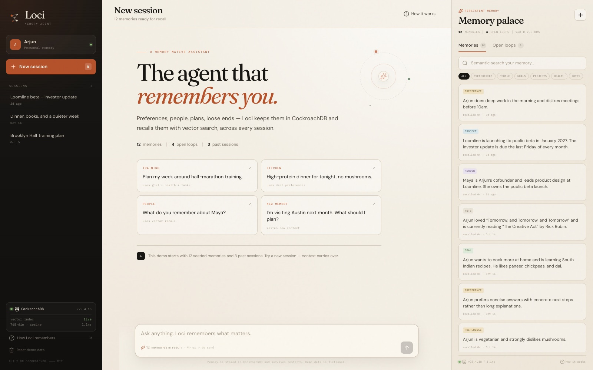
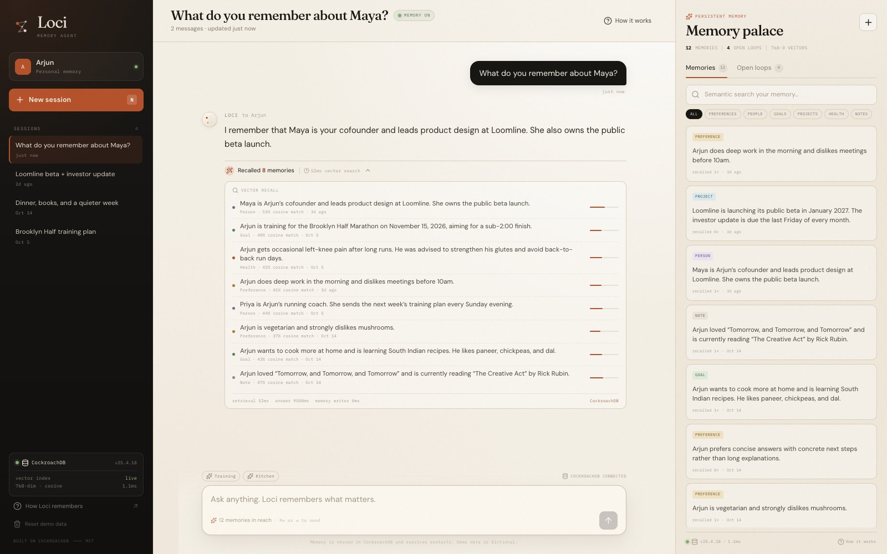
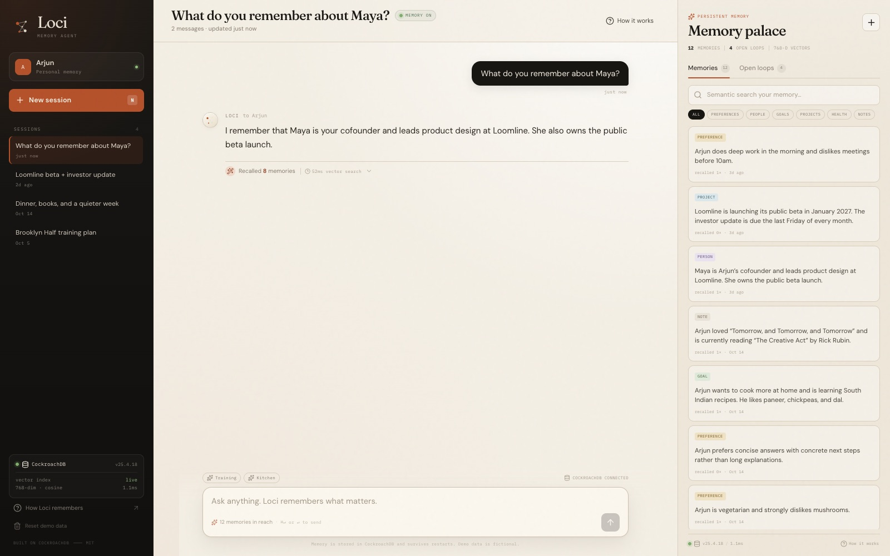
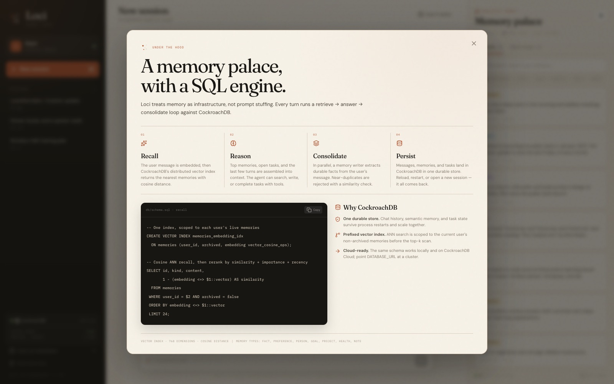
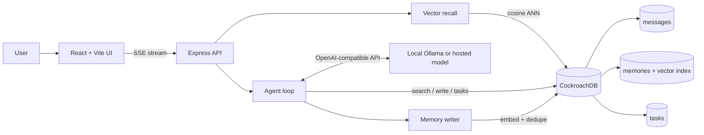

# Loci

**The agent that remembers you.**

Loci is a memory-native personal assistant built on **CockroachDB**. Every conversation,
preference, relationship, goal, and open task lives in one durable database. Start a new
session, restart the server, or come back tomorrow — Loci recalls what matters with
**distributed vector indexing**.



[**Watch the 83-second demo video →**](docs/loci-demo.mp4) · [captions](docs/loci-demo.srt)

## What it demonstrates

- **Persistent agent memory** — messages, memories, and tasks are stored in CockroachDB,
  not in a prompt or a process-local store.
- **Vector recall on every turn** — the user message is embedded and matched against stored
  memories with cosine distance (the `<=>` operator).
- **A prefixed distributed vector index** — ANN search is scoped to one user's live memories
  before the top-k scan.
- **Retrieve → reason → consolidate** — the agent answers with recalled context, while a
  parallel memory writer extracts durable facts and dedupes near-identical ones.
- **Agent tools** — semantic memory search, memory writes, task creation, listing, and completion.
- **A visible memory trace** — each reply shows the recalled memories, similarity scores,
  tool calls, and write timing.





## CockroachDB feature used

### Distributed Vector Indexing

The demo's required CockroachDB capability is a **prefixed vector index**:

```sql
CREATE VECTOR INDEX memories_embedding_idx
  ON memories (user_id, archived, embedding vector_cosine_ops);
```

`user_id` and `archived` are prefix columns, so an ANN query only considers the current
user's non-archived memories. The query orders by cosine distance and limits the scan:

```sql
SELECT id, kind, content, importance,
       1 - (embedding <=> $1::vector) AS similarity
  FROM memories
 WHERE user_id = $2 AND archived = false
 ORDER BY embedding <=> $1::vector
 LIMIT 24;
```

This is a single-store design: the same CockroachDB cluster holds chat history, semantic
memory, tasks, recall counters, and the embeddings that power retrieval. The schema also
works unchanged against CockroachDB Cloud — point `DATABASE_URL` at a cloud cluster.



> **Optimizer note:** on a small demo dataset, run `ANALYZE memories` after seeding so the
> optimizer chooses the vector index. The seed script does this automatically.

## Architecture



### The loop

1. **Recall** — embed the user message, run cosine ANN over `memories`, fetch open tasks.
2. **Reason** — assemble the top memories, open tasks, and recent turns into the agent context.
   The model may call tools (`search_memory`, `save_memory`, `create_task`, `list_tasks`,
   `complete_task`).
3. **Consolidate** — in parallel, a memory writer extracts up to three durable facts from the
   user's message. Questions and small talk are skipped; statements such as “My sister Nisha
   is a pediatrician in Boston” become standalone third-person memories.
4. **Persist** — the reply, trace, new memories, and task changes are written back to
   CockroachDB. The next session starts with the same memory.

### Memory types

`fact`, `preference`, `person`, `goal`, `project`, `health`, `note`.

## Stack

- **Database:** CockroachDB v25.4.18, `VECTOR(768)` + distributed vector index
- **Server:** Node.js, TypeScript, Express, `pg`
- **Client:** React 19, Vite, React Markdown
- **Models:** any OpenAI-compatible endpoint; local default is Ollama with
  `qwen2.5:3b` for chat and `nomic-embed-text` for 768-dimensional embeddings
- **Streaming:** Server-Sent Events (SSE)
- **UI:** warm archival-paper aesthetic, live memory palace, recall trace, open loops

## Quick start

### Prerequisites

- Node.js 22+
- Docker (or a CockroachDB cluster)
- [Ollama](https://ollama.com) with the two models below, or an OpenAI-compatible API key

### 1. Install

```bash
git clone https://github.com/arj-co/loci.git
cd loci
npm install
cp .env.example .env
```

### 2. Start CockroachDB

```bash
docker compose up -d
```

This starts a single-node CockroachDB on `localhost:26257`; the DB Console is at
[http://localhost:8091](http://localhost:8091).

### 3. Pull the local models

```bash
ollama pull qwen2.5:3b
ollama pull nomic-embed-text
```

### 4. Create the schema and seed the demo

```bash
npm run setup
```

This creates the `loci` database, applies `db/schema.sql`, seeds 12 memories, 3 past
sessions, and 5 tasks for the demo user **Arjun**, then runs `ANALYZE memories`.

### 5. Run it

```bash
npm run dev
```

- App: [http://localhost:5173](http://localhost:5173)
- API: [http://localhost:3000](http://localhost:3000)

For a production build:

```bash
npm run build
npm start
```

## Configuration

Copy `.env.example` to `.env`. The important knobs:

| Variable | Default | Purpose |
| --- | --- | --- |
| `DATABASE_URL` | `postgresql://root@localhost:26257/loci?sslmode=disable` | CockroachDB connection string |
| `LLM_BASE_URL` | `http://localhost:11434/v1` | Chat completions endpoint |
| `LLM_MODEL` | `qwen2.5:3b` | Chat model |
| `EMBEDDING_BASE_URL` | `http://localhost:11434/v1` | Embeddings endpoint |
| `EMBEDDING_MODEL` | `nomic-embed-text` | 768-dimensional embedding model |
| `EMBEDDING_DIM` | `768` | Must match the schema's `VECTOR(768)` |
| `MEMORY_TOP_K` | `8` | Memories passed to the model each turn |
| `MEMORY_CANDIDATES` | `24` | ANN candidates fetched before reranking |
| `MEMORY_DEDUPE_THRESHOLD` | `0.88` | Cosine similarity above which a new memory is deduped |
| `DEMO_USER_HANDLE` | `arjun` | Demo user created on first boot |

The demo has an offline fallback for embeddings (`EMBEDDING_PROVIDER=hash`) for tests where
no embedding server is available. It is deterministic but not semantic; use Ollama or a
hosted embedding model for the real demo.

## Scripts

| Command | What it does |
| --- | --- |
| `npm run dev` | API + Vite dev server |
| `npm run dev:server` | API only, with watch |
| `npm run dev:web` | Vite only |
| `npm run build` | Build the client into `dist/client` |
| `npm start` | Run the production server (serves the built client) |
| `npm run db:migrate` | Create the database and apply the schema |
| `npm run db:seed` | Seed demo data if the user has no memories |
| `npm run db:reset` | Delete and reseed the demo user's data |
| `npm run typecheck` | TypeScript check |

The UI also exposes **Reset demo data** in the sidebar.

## A short demo script

1. Open the app. Notice the **Memory palace** on the right: 12 seeded memories, 4 open loops,
   and a live vector index readout.
2. Ask **“What do you remember about Maya?”**. The reply uses recalled memories, and the
   trace shows the cosine matches.
3. Start a new session and say **“My sister Nisha is a pediatrician in Boston.”** Watch a new
   memory appear in the palace.
4. Start another new session and ask **“Tell me about Nisha.”** The fact persists and is
   recalled across sessions.
5. Ask **“Add a task to email Nisha this weekend.”** A task lands in the Open loops panel and
   the reply confirms the due date.
6. Open **How it works** to see the prefixed vector index and the retrieve → reason →
   consolidate loop.

## API

| Method | Route | Purpose |
| --- | --- | --- |
| `GET` | `/api/health` | DB, model, and vector-index status |
| `GET` | `/api/bootstrap` | User, sessions, memories, tasks, stats |
| `POST` | `/api/sessions` | Create a session |
| `GET` | `/api/sessions/:id` | Session + messages |
| `DELETE` | `/api/sessions/:id` | Delete a session |
| `POST` | `/api/sessions/:id/chat` | Stream a turn (SSE) |
| `GET` | `/api/memories?q=&kind=` | List or semantic-search memories |
| `POST` | `/api/memories` | Add a memory manually |
| `DELETE` | `/api/memories/:id` | Archive a memory |
| `GET` | `/api/tasks?status=` | List tasks |
| `POST` | `/api/tasks` | Create a task |
| `PATCH` | `/api/tasks/:id` | Update or complete a task |
| `POST` | `/api/demo/reset` | Reset and reseed the demo |

## Design notes and limitations

- **Small local model, honest tradeoffs.** The default `qwen2.5:3b` runs on a laptop without
  an API key. It occasionally rambles; the server adds deterministic handling for simple task
  confirmations and task-list questions, and the prompt enforces short second-person replies.
- **One store, not a cache.** Memories are deduped with vector similarity and archived rather
  than deleted, so recall history stays inspectable.
- **Users are scoped by prefix.** Every memory query includes `user_id` and `archived`; the
  UI's demo reset only removes the demo user's rows.
- **Not production auth.** The demo user is selected by `DEMO_USER_HANDLE`; add real auth and
  per-user identity before deploying.
- **Embedding dimension is fixed** at 768 in `db/schema.sql`. To change it, update
  `EMBEDDING_DIM`, reset the database, and rebuild the vector index.

## License

MIT — see [LICENSE](LICENSE).
